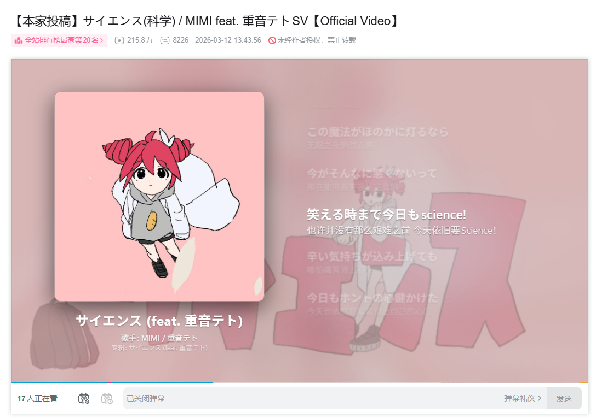

# BiliMusicScreen

B 站在网页端没有听视频的功能，虽然已经有不少大佬制作了专门在 B 站听音乐的项目，但他们大多是独立软件或没有直接改到播放器的浏览器扩展。

在受到之前用过的独立软件 [SaltPlayer](https://github.com/Moriafly/SaltPlayerSource) 和 BetterNCM 中的一个插件 [Refined Now Playing](https://github.com/solstice23/refined-now-playing-netease) 等界面设计上的启发用AI编写了这个浏览器扩展/用户脚本。

> [!IMPORTANT]
> 该脚本完全由 AI（[Deepseek](https://www.deepseek.com/) ，v4.1-flash）编写，我只检查了可用性以及简单的安全性检查，可能有 bug 或风险，如果介意请不要使用。

BiliMusicScreen 是一个适用于 B 站视频详情页的音乐播放插件/脚本，可以让你在 B 站视频播放器上获得在音乐平台或者是本地音乐播放器上的听歌体验。

它的特性包括：

- 简单的 Twist 流体效果
- 歌曲信息显示
- 可视化音频频谱
- 多种数据源以及歌词（B 站识别出来的「发现音乐」、当前视频和网易云音乐）

其中歌词由网易云音乐提供，但不获取音频文件，音频流完全由 B 站提供。

**安装后的默认效果:**

如果你想观看 MV，可以在流体效果设置中拉高视频不透明度，并添加适当的模糊。

**修改后的效果:**

## 使用
把对应的文件安装之后，在播放器设置里面点击音符，再从打开的页面中点击启用音乐屏幕即可
